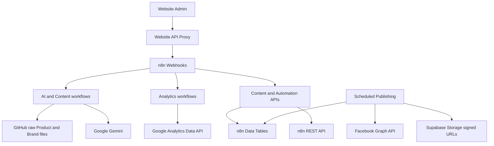

# n8n Integration Architecture

**Nguồn đối chiếu:** 19 workflow JSON exports ngày 25/11/2026. Tài liệu mô tả kiến trúc và cấu hình thể hiện trong exports; không thay thế execution logs hoặc kiểm tra trực tiếp trên môi trường triển khai.

## 1. Sơ đồ logic

## 2. Integration inventory

| Hệ thống | Vai trò trong export | Giới hạn cần xác minh |
|---|---|---|
| GitHub raw content | Đọc `src/data/products.ts` và `docs/docs/marketing-skills/product-marketing-context.md` từ repo nguồn, branch `feature/ga4-ai-agent` | Nội dung branch có thể thay đổi; chưa pin version/commit |
| Google Gemini | Sinh AI Assistant response, content, campaign plan, marketing insights | Credential reference có trong export; model cụ thể không thể kết luận chỉ từ node |
| Google Analytics Data API | runReport cho GA4 Property `557199346` | Analytics API và Dashboard API dùng credential type khác nhau |
| n8n REST API | List workflows, executions, get workflow details, activate/deactivate | URL localhost phụ thuộc network namespace |
| n8n Data Tables | Content Calendar và Content Library | Schema hiện tại trên instance cần xác minh |
| Facebook Graph API | Đăng text/album/video và kiểm tra token | Không xác nhận token còn hiệu lực hoặc quyền Page |
| Supabase Storage | Signed URL để Facebook tải media | Không xác nhận bucket policy/expiry |
| Website API Proxy | Chuyển tiếp request website sang n8n | Không nằm trong ZIP; đối chiếu source code riêng |

## 3. Credential references nhìn thấy

Chỉ ghi tên tham chiếu, không có secret value:
- Google Gemini(PaLM) Api account
- Google Analytics account
- GA4 Data API
- GIAO THOI Page Token New
- Giao Thoi Admin API Auth
- GIAO THOI Calendar Webhook Auth

Không commit credential ID, API key, access token, refresh token, webhook secret hoặc service-role key.

## 4. GA4 API details

Property ID: `557199346`.

Analytics API có 6 báo cáo:
1. Overview: sessions, activeUsers, newUsers, screenPageViews, engagedSessions, eventCount.
2. Trend: date × sessions, activeUsers, screenPageViews.
3. Acquisition: sessionDefaultChannelGroup × sessions, activeUsers, engagedSessions.
4. Devices: deviceCategory × sessions, activeUsers.
5. Pages: pagePath × screenPageViews, activeUsers.
6. Events: eventName × eventCount, totalUsers.

Analytics API nhận period 7/28/90 và endDate yesterday. **Sai khác cần kiểm tra:** GA4 Devices đang hard-code 7daysAgo–yesterday, không dùng period động. Khi period 28/90, thiết bị có thể lệch kỳ.

Dashboard API truy vấn overview, trend, acquisition và trả dataPeriod cố định `7daysAgo - yesterday`.

## 5. Operational boundaries and design requirements

### 5.1. Website API Proxy and webhook access

API Proxy là lớp trung gian giữa website và n8n. Quyền truy cập cần được kiểm soát ở phía server thông qua xác thực phiên, kiểm tra vai trò và xác thực request tới webhook. Việc frontend sử dụng API Proxy không tự động ngăn truy cập trực tiếp đến webhook nếu webhook vẫn public và không có cơ chế xác thực riêng.

### 5.2. Workflow management

Các thao tác list, inspect, activate/deactivate và execute workflow sử dụng n8n REST API. Những thao tác thay đổi trạng thái cần allowlist workflow IDs, phân quyền theo vai trò và audit log. URL `localhost:5678` chỉ có ý nghĩa trong network namespace của tiến trình gọi; cấu hình phải phản ánh nơi API client thực sự chạy.

### 5.3. GitHub raw content

Các endpoint raw GitHub được sử dụng để đọc Product Data, Brand Knowledge, Skills và References. Nội dung trả về thay đổi theo branch và commit của repository nguồn. Với các tài liệu ảnh hưởng trực tiếp đến dữ kiện sản phẩm và thương hiệu, cần quản lý branch phát hành và quy trình cập nhật nguồn nhất quán.

### 5.4. Credentials and external permissions

Credential reference trong workflow không thể hiện secret value, quyền OAuth scope hoặc trạng thái token. Gemini, GA4, Facebook Graph API và Supabase cần được cấp quyền theo nguyên tắc đặc quyền tối thiểu; token và secret phải được quản lý ngoài repository.

### 5.5. Data Tables and media

Data Tables lưu dữ liệu Content Calendar/Content Library theo schema của instance n8n. Facebook Graph API sử dụng quyền Page tương ứng để đăng nội dung; Supabase Storage cung cấp media URL theo cấu hình. Quyền bucket, thời hạn signed URL, trạng thái approval và khả năng retry cần nhất quán trong quy trình publish.

### 5.6. GA4 reporting period

Analytics API có các báo cáo Overview, Trend, Acquisition, Devices, Pages và Events. Analytics API hỗ trợ period 7/28/90 ngày ở phần lớn truy vấn; GA4 Devices dùng khoảng cố định `7daysAgo–yesterday`, trong khi Dashboard API cũng trả kỳ cố định này. Khi xây dựng báo cáo nhiều nhóm chỉ số, startDate/endDate cần được đồng bộ và trả kèm metadata kỳ dữ liệu.

### 5.7. Schedule and timezone

Workflow scheduled publishing xử lý thời gian theo UTC+7 trong phần code được phân tích. Cấu hình timezone của n8n instance, Schedule Trigger, lịch lưu trong Data Tables và frontend cần sử dụng cùng quy ước để tránh lệch ngày/giờ.

## 6. Phạm vi bằng chứng

Sơ đồ và inventory trong tài liệu được tổng hợp từ cấu trúc workflow exports. Chúng mô tả các thành phần, endpoint và kết nối được khai báo; không tự chứng minh endpoint đang truy cập được, credentials còn hiệu lực, quyền dịch vụ đã được cấp hoặc workflow đang thực thi thành công. Các trạng thái vận hành cần được đánh giá từ cấu hình triển khai và execution logs tương ứng.
