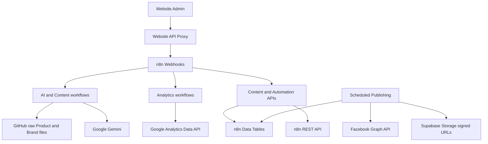

# n8n Integration Architecture

> Nguồn: 19 workflow JSON export ngày 25/11/2026. Mô tả cấu hình khai báo, chưa phải runtime test.

## 1. Sơ đồ logic

## 2. Integration inventory

| Hệ thống | Vai trò trong export | Giới hạn cần xác minh |
|---|---|---|
| GitHub raw content | Đọc `src/data/products.ts` và `docs/docs/marketing-skills/product-marketing-context.md` từ repo nguồn, branch `feature/ga4-ai-agent` | Nội dung branch có thể thay đổi; chưa pin version/commit |
| Google Gemini | Sinh AI Assistant response, content, campaign plan, marketing insights | Credential reference có trong export; model cụ thể không thể kết luận chỉ từ node |
| Google Analytics Data API | runReport cho GA4 Property `557199346` | Analytics API và Dashboard API dùng credential type khác nhau |
| n8n REST API | List workflows, executions, get workflow details, activate/deactivate | URL localhost phụ thuộc network namespace |
| n8n Data Tables | Content Calendar và Content Library | Schema hiện tại trên instance cần xác minh |
| Facebook Graph API | Đăng text/album/video và kiểm tra token | Không xác nhận token còn hiệu lực hoặc quyền Page |
| Supabase Storage | Signed URL để Facebook tải media | Không xác nhận bucket policy/expiry |
| Website API Proxy | Chuyển tiếp request website sang n8n | Không nằm trong ZIP; đối chiếu source code riêng |

## 3. Credential references nhìn thấy

Chỉ ghi tên tham chiếu, không có secret value:
- Google Gemini(PaLM) Api account
- Google Analytics account
- GA4 Data API
- GIAO THOI Page Token New
- Giao Thoi Admin API Auth
- GIAO THOI Calendar Webhook Auth

Không commit credential ID, API key, access token, refresh token, webhook secret hoặc service-role key.

## 4. GA4 API details

Property ID: `557199346`.

Analytics API có 6 báo cáo:
1. Overview: sessions, activeUsers, newUsers, screenPageViews, engagedSessions, eventCount.
2. Trend: date × sessions, activeUsers, screenPageViews.
3. Acquisition: sessionDefaultChannelGroup × sessions, activeUsers, engagedSessions.
4. Devices: deviceCategory × sessions, activeUsers.
5. Pages: pagePath × screenPageViews, activeUsers.
6. Events: eventName × eventCount, totalUsers.

Analytics API nhận period 7/28/90 và endDate yesterday. **Sai khác cần kiểm tra:** GA4 Devices đang hard-code 7daysAgo–yesterday, không dùng period động. Khi period 28/90, thiết bị có thể lệch kỳ.

Dashboard API truy vấn overview, trend, acquisition và trả dataPeriod cố định `7daysAgo - yesterday`.

## 5. Việc cần xác minh

- API proxy là đường truy cập duy nhất; direct webhook có bị chặn khi thiếu auth không?
- Xử lý duplicate POST `giaothoi-content-library-save`.
- `localhost:5678` có đúng network namespace không?
- Credential scopes/quyền còn hiệu lực không?
- Branch GitHub raw có phải branch phát hành được duyệt không?
- Schedule Trigger timezone có thống nhất UTC+7 không?
- Analytics API và Dashboard API có cùng kỳ dữ liệu như kỳ vọng không?
